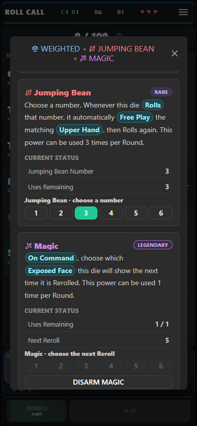
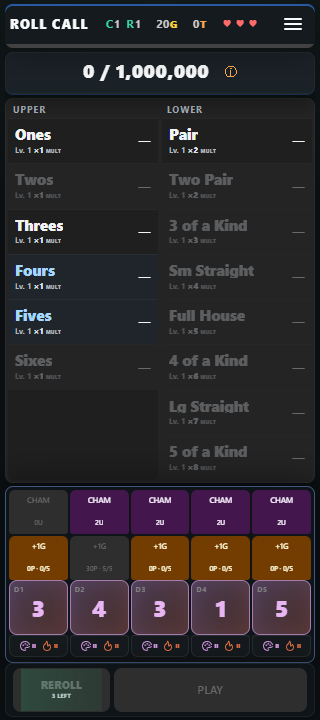
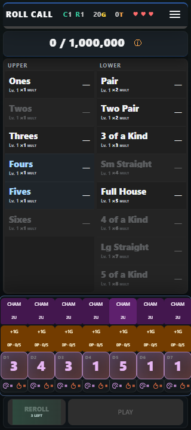
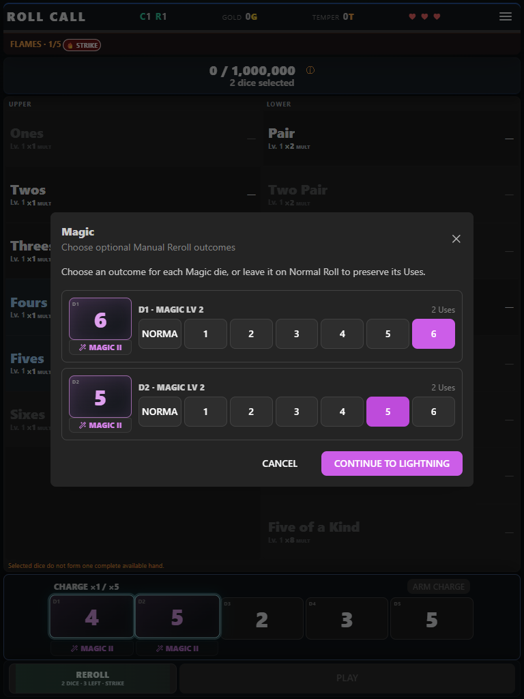
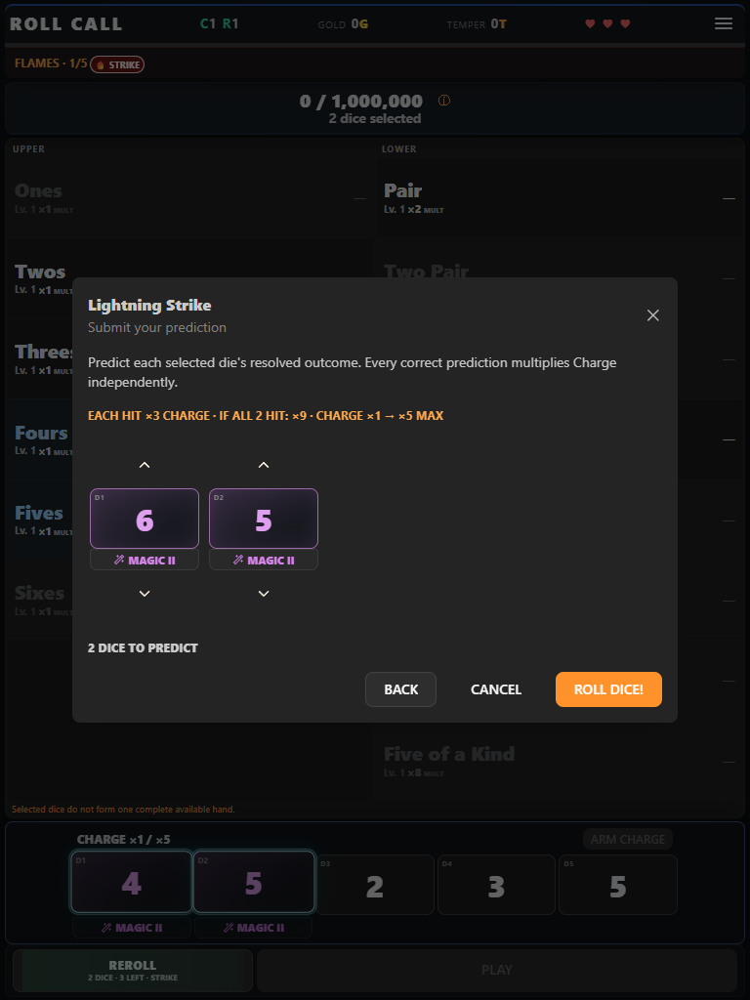
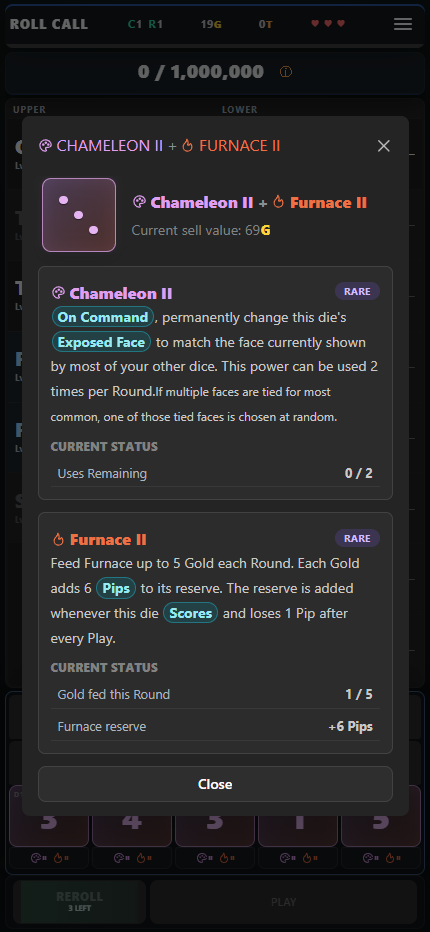

# Dice Effects Interaction Redesign

## Summary

This pass removes all activation and configuration controls for Chameleon, Furnace, Magic, Weighted, and Jumping Bean from Die Details.

- Chameleon now has a per-die `CHAM` action above the die. It invokes the existing authoritative command immediately and displays remaining Uses.
- Furnace now has a per-die `+1G` action above the die. Each press commits the existing one-Gold feed action and displays reserve Pips plus Round progress.
- Magic is offered contextually after the player presses Reroll. It is optional per selected die and is committed atomically with the Manual Reroll.
- Weighted automatically favors the highest rank in the die's current face definitions.
- Jumping Bean automatically triggers on the lowest rank in the die's current face definitions.
- Die Details remains informational and shows current derived ranks, Uses, reserve, level, descriptions, and sell value.

Chameleon and Furnace controls are independent on forged dice. Exhausting or suppressing one effect does not disable the other.

## Magic Manual Reroll resolution

`MANUAL_REROLL` now accepts an optional list of per-die Magic outcome choices. The engine validates that every choice:

1. belongs to the submitted Manual Reroll;
2. references an equipped player die with Magic;
3. has an available, unsuppressed Use; and
4. matches one of the die's current distinct outcomes.

The choice is carried into the existing roll batch and resolved at Magic's established controller priority. A Use is spent only when the Manual Reroll resolves that chosen outcome. Dice left on Normal Roll do not spend Magic.

No persistent armed state is created. Automatic Rolls, post-Play Rolls, Dare Devil, Jumping Bean follow-ups, and other effect-generated Rolls cannot activate Magic.

The UI derives choices with `distinctDieOutcomes`, so duplicate numerical faces appear once while still resolving to the first matching physical face under the existing deterministic controller rule. This also supports a seven-rank die or other nonstandard current face definitions.

## Magic and Lightning Strike

When both effects apply, the sequence is:

1. Magic modal: choose an outcome or Normal Roll independently for every eligible Magic die.
2. Lightning Strike modal: predict every selected die.
3. `ROLL DICE!`: submit one `ACTIVATE_LIGHTNING_STRIKE` action containing both prediction and Magic choice payloads.

Magic-controlled predictions initialize to the forced outcomes but remain editable. Back returns to Magic without losing its selections. Cancel, Escape, or close dismisses the entire pending reroll and restores focus to the Reroll button. No Magic Uses, Flywheel Uses, normal Rerolls, Care Package Rerolls, or other resources are spent before the final action is committed.

Lightning continues to evaluate the resolved outcome of the original Manual Reroll batch. A matching Magic-forced outcome is therefore a hit, while later Jumping Bean follow-up Rolls do not replace that outcome.

## Dynamic rank calculations

Weighted uses `max(die.faces[].rank)` each time a genuinely randomized Roll is resolved. Every physical face showing that rank receives the existing level-scaled weight, preserving duplicate-face probability and controller priority.

Jumping Bean uses `min(die.faces[].rank)` after each resolved eligible Roll. Matching that derived rank queues the existing Free Play and follow-up Roll chain, preserving the three-Uses-per-level cap and iterative queue drain.

The existing `jumpingBeanFreePlays` run statistics record activation frequency. Roll-batch history and parent sequence links retain enough information to inspect chain length and the original Manual Reroll separately from automatic follow-ups.

## Forged-die responsive layout

Direct actions use a reserved, aligned stack above each die. Each action is a separate 44-pixel-tall button with its own validation result, title, and accessible unavailable explanation.

Audited widths: 320, 375, 430, 768, and 1440 pixels. Five forged dice with both actions showed no document or dock overflow and retained at least 44×44 CSS-pixel targets. A seven-die expanded Roster was also audited at 320 pixels; the dock uses an edge-to-edge, one-pixel-gap layout and clips one internal fractional rounding pixel while producing no document-level horizontal overflow.

The two-action stack adds 88 pixels above the dice. This is intentionally visible rather than hidden behind a menu. On the smallest viewport the controls use abbreviated visual labels, while full purpose, progress, and disabled reasons remain in accessible labels and titles.

## Save compatibility

- Legacy `weightedFace` and `jumpingBeanNumber` fields remain in persisted effect state so older saves deserialize normally, but gameplay ignores them.
- Legacy runtime `magicArmedFace` remains readable for schema compatibility and is explicitly normalized to `null` when Round state is repaired.
- Obsolete arm/disarm/configuration actions remain recognizable in old action journals, but authoritative validation rejects new attempts to execute them.
- Round invocation capacities, reset behavior, effect IDs, Forge merging, and persistent Chameleon face mutations are unchanged.

## Before and after screenshots

### Before: controls inside Die Details

### After: five forged dice with both direct controls at 320px

### After: expanded seven-die Roster at 320px

### After: Magic choices for multiple dice

### After: Lightning Strike following Magic

### After: informational Die Details

Additional direct-control captures are available for 375, 430, 768, and 1440 pixels in `docs/dice-effects-redesign/screenshots/`.

## Validation results

- Focused redesigned-flow gameplay tests: passed.
- Complete Vitest unit/integration suite: **846 passed across 79 files**.
- Complete Playwright suite: **171 passed**.
- Post-audit focused Playwright rerun, including seven-die mobile layout and modal focus restoration: **2 passed**.
- TypeScript `tsc --noEmit`: passed.
- Production Vite build: passed.
- Existing snapshot-reuse, resolution-architecture, event-order, and performance-regression unit tests: passed as part of the complete suite.

The production build retains the repository's existing warning that the main minified JavaScript chunk exceeds 500 kB. This redesign does not add a new render-time Hand enumeration or Board snapshot path: direct controls inspect only their die effects, and Magic outcome enumeration is limited to selected dice while its modal is active.

## Remaining concerns

- Jumping Bean's lowest-rank rule is intentionally experimental. Dice whose face definitions collapse to one low rank can still chain until invocation exhaustion; the existing iterative queue and event limits prevent recursion, but frequency and score impact should be evaluated in playtesting.
- Magic can intentionally force the derived Jumping Bean trigger and can guarantee a matching Lightning prediction. These are explicit interactions, not compensating balance changes.
- A fully expanded seven-die Roster with two controls per die is visually dense at 320 pixels, although it remains operable, uses 44-pixel controls, and does not create page-level horizontal overflow.
