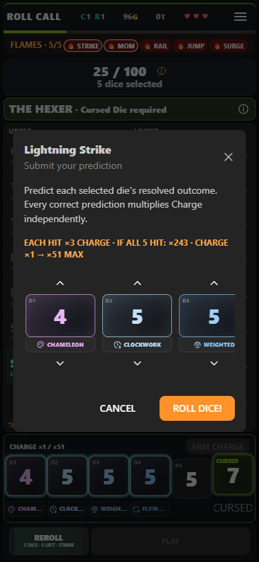
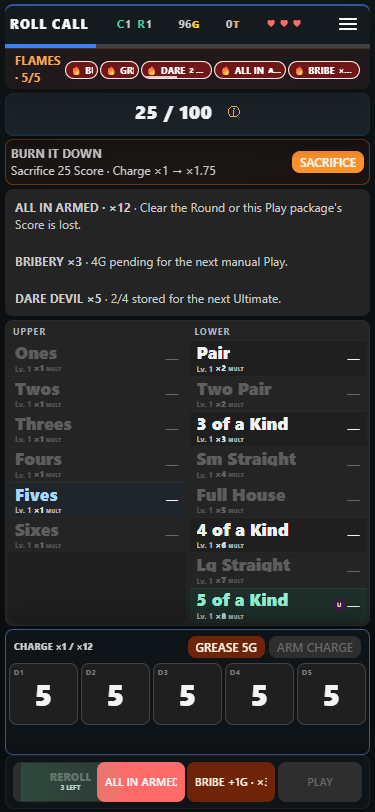
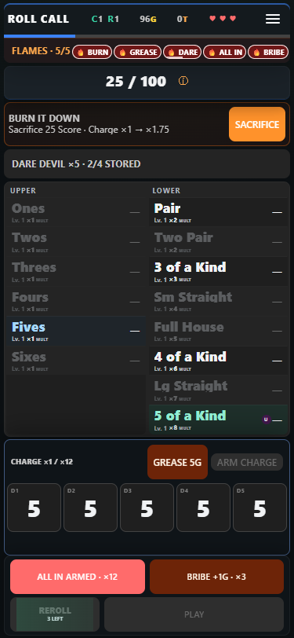
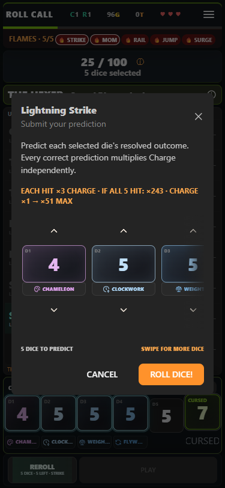
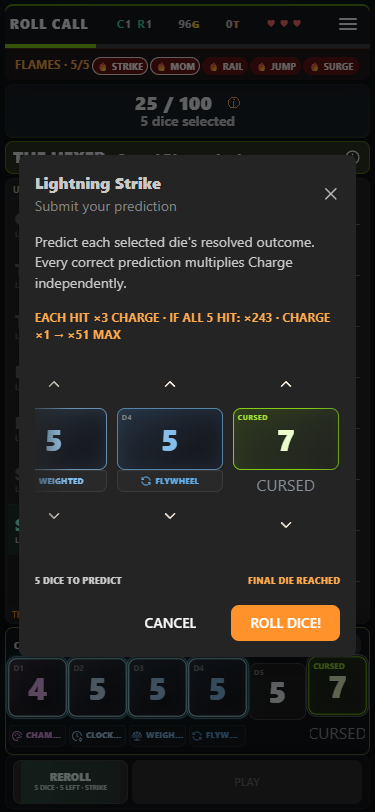

# Flame Controls UX Audit

Audit date: November 14, 2026

## Scope and method

This audit covers Burn It Down, Grease the Engine, Lightning Strike, Dare Devil, All In, and Bribery after removal of the Flame Actions menu. The review used live Chrome screenshots at 375×812, 430×932, 768×1024, and 1440×1000. States included enabled, disabled, armed/pending, five-die Lightning Strike prediction, and Dare Devil interception.

The browser harness also verified modal focus entry, keyboard access to prediction controls, Escape dismissal, focus restoration to the originating Reroll or Play button, and absence of the obsolete Flame Actions surface.

## Screenshot index

| Viewport | Armed/pending controls | Lightning Strike, five mixed dice | Disabled controls | Dare Devil |
| --- | --- | --- | --- | --- |
| 375 mobile | [View](./flame-ux-audit/screenshots/375-mobile-contextual-pending.png) | [View](./flame-ux-audit/screenshots/375-mobile-lightning-five-mixed.png) | [View](./flame-ux-audit/screenshots/375-mobile-contextual-disabled.png) | [View](./flame-ux-audit/screenshots/375-mobile-dare-devil.png) |
| 430 mobile | [View](./flame-ux-audit/screenshots/430-mobile-contextual-pending.png) | [View](./flame-ux-audit/screenshots/430-mobile-lightning-five-mixed.png) | — | — |
| 768 tablet | [View](./flame-ux-audit/screenshots/768-tablet-contextual-pending.png) | [View](./flame-ux-audit/screenshots/768-tablet-lightning-five-mixed.png) | — | — |
| 1440 desktop | [View](./flame-ux-audit/screenshots/1440-desktop-contextual-pending.png) | [View](./flame-ux-audit/screenshots/1440-desktop-lightning-five-mixed.png) | [View](./flame-ux-audit/screenshots/1440-desktop-contextual-disabled.png) | [View](./flame-ux-audit/screenshots/1440-desktop-dare-devil.png) |

Representative mobile states:

## Post-audit refinement

The focused refinement is complete. It changes presentation, responsive layout, and accessibility only; Flame eligibility, rewards, costs, reroll/Play consumption, and resolution ordering are unchanged.

### Before and after: primary mobile findings

| Finding | Before | After |
| --- | --- | --- |
| Crowded Play controls and duplicated state | [375px before](./flame-ux-audit/screenshots/375-mobile-contextual-pending-before.png) | [375px after](./flame-ux-audit/screenshots/375-mobile-contextual-pending-after.png) |
| Lightning overflow was not discoverable | [375px before](./flame-ux-audit/screenshots/375-mobile-lightning-five-mixed-before.png) | [375px after](./flame-ux-audit/screenshots/375-mobile-lightning-five-mixed-after.png) |
| Disabled reasons depended on hover/title | [375px before](./flame-ux-audit/screenshots/375-mobile-contextual-disabled-before.png) | [375px after](./flame-ux-audit/screenshots/375-mobile-contextual-disabled-after.png) |
| Final cursed die reachability | — | [375px scrolled to final die](./flame-ux-audit/screenshots/375-mobile-lightning-final-die-after.png) |

### Updated responsive captures

| Viewport | Armed/pending controls | Lightning Strike | Disabled controls | Dare Devil |
| --- | --- | --- | --- | --- |
| 375 mobile | [View](./flame-ux-audit/screenshots/375-mobile-contextual-pending-after.png) | [Initial](./flame-ux-audit/screenshots/375-mobile-lightning-five-mixed-after.png) · [Final die](./flame-ux-audit/screenshots/375-mobile-lightning-final-die-after.png) | [View](./flame-ux-audit/screenshots/375-mobile-contextual-disabled-after.png) | [View](./flame-ux-audit/screenshots/375-mobile-dare-devil-after.png) |
| 430 mobile | [View](./flame-ux-audit/screenshots/430-mobile-contextual-pending-after.png) | [Initial](./flame-ux-audit/screenshots/430-mobile-lightning-five-mixed-after.png) · [Final die](./flame-ux-audit/screenshots/430-mobile-lightning-final-die-after.png) | [View](./flame-ux-audit/screenshots/430-mobile-contextual-disabled-after.png) | [View](./flame-ux-audit/screenshots/430-mobile-dare-devil-after.png) |
| 768 tablet | [View](./flame-ux-audit/screenshots/768-tablet-contextual-pending-after.png) | [View](./flame-ux-audit/screenshots/768-tablet-lightning-five-mixed-after.png) | [View](./flame-ux-audit/screenshots/768-tablet-contextual-disabled-after.png) | [View](./flame-ux-audit/screenshots/768-tablet-dare-devil-after.png) |
| 1440 desktop | [View](./flame-ux-audit/screenshots/1440-desktop-contextual-pending-after.png) | [View](./flame-ux-audit/screenshots/1440-desktop-lightning-five-mixed-after.png) | [View](./flame-ux-audit/screenshots/1440-desktop-contextual-disabled-after.png) | [View](./flame-ux-audit/screenshots/1440-desktop-dare-devil-after.png) |

### Finding resolution

- **H1 — Resolved.** Burn It Down keeps a short inline disabled reason on mobile. Grease the Engine, All In, and Bribery each expose a 44px information target beside the disabled action; it opens the reason on tap, hover, or keyboard focus. The same reason remains in the accessible name, while the action itself stays disabled.
- **H2 — Resolved.** Lightning prediction arrows, Burn It Down, Grease the Engine, All In, Bribery, Play, and Reroll now have effective targets of at least 44×44 CSS pixels. The responsive browser test measures these targets directly.
- **M1 — Resolved.** Lightning Strike now shows the total prediction count, an edge fade, `SWIPE FOR MORE DICE`, per-die scroll snapping, and a `FINAL DIE REACHED` state. The cue updates from the row's real scroll position, and the browser test confirms The Hexer's cursed die is fully within the viewport at the end.
- **M2 — Resolved.** At 375px and 430px, All In and Bribery occupy a dedicated modifier row above the primary Reroll/Play row. With one modifier the control expands cleanly; with none, the action area returns to its original single-row height. Tablet and desktop placement is unchanged.
- **L1 — Resolved.** All In and Bribery state now appears only in their action controls. The separate persistent block is reduced to the stored Dare Devil Ultimate bonus (and unrelated wagers when present).
- **L2 — Resolved.** The six contextual Flame badges are inventory-only labels; their pending descriptions no longer compete for chip width. Full details remain available by activating a badge, and the narrow strip can scroll instead of truncating each badge.

### Refinement validation

- Unit/integration: 804 tests passed.
- Responsive screenshot and accessibility harness: 17 tests passed across 375px, 430px, 768px, and 1440px.
- Focused Flame browser flows: passed, including All In arming/disarming, Dare Devil interception, Lightning prediction focus restoration, and contextual Burn/Grease controls.
- Full browser regression after the Bribery assertion update: 159 of 159 tests passed in 4.9 minutes.
- TypeScript and production build: passed. Vite retains the existing large-chunk advisory.
- The harness also checks no horizontal page overflow, one/no/two modifier layouts, 44px targets, touch-opened disabled reasons, final-die reachability, modal Escape dismissal, and focus restoration.
- Remaining issues: no Flame-control behavior or layout regressions were observed.

## Critical

No Critical findings. All six interactions remained reachable, the modals stayed within each viewport, and no tested state blocked the core Play or Reroll flow.

## High

### H1 — Disabled reasons are not visible on narrow touch screens

- Affected screen: 375px disabled contextual controls; also applies to compact All In, Bribery, and Grease controls at other widths.
- Reproduction: own Burn It Down, Grease the Engine, All In, and Bribery; set Round Score and Gold to zero, Charge to maximum, mark All In used, and reach the Bribery Round cap. At 375px, Burn It Down's inline reason is hidden by the mobile CSS rule. The other compact controls expose their reasons only through `title` and accessible names.
- Impact: keyboard and screen-reader users receive useful explanations, but sighted touch users cannot discover why the controls are unavailable because hover titles are not available.
- Recommendation: keep a short visible reason near the affected control, or provide a tap/focus-triggered shared explanation using `aria-describedby`. Do not rely on `title` as the only visible explanation.
- Evidence: [375px disabled state](./flame-ux-audit/screenshots/375-mobile-contextual-disabled.png), [1440px disabled state](./flame-ux-audit/screenshots/1440-desktop-contextual-disabled.png).

### H2 — Several Flame actions have undersized touch targets

- Affected screen: Lightning Strike selectors, Burn It Down, Grease the Engine, All In, Bribery, and the mobile Play cluster.
- Reproduction: open the five-die Lightning modal at 375px, then inspect the up/down controls; each arrow is 28×28px. Burn It Down and Grease the Engine measure 22px high. The Reroll, All In, Bribery, and Play controls measure 40px high.
- Impact: prediction changes and irreversible Gold/Score actions are vulnerable to missed or accidental taps, especially when used repeatedly or one-handed.
- Recommendation: give every interactive target at least a 44×44px hit area. The visible glyph/button can remain compact by adding transparent padding or a larger pseudo-element hit box. Prioritize Lightning arrows and the irreversible Burn/Grease actions.
- Evidence: [375px Lightning modal](./flame-ux-audit/screenshots/375-mobile-lightning-five-mixed.png), [375px contextual controls](./flame-ux-audit/screenshots/375-mobile-contextual-pending.png).

## Medium

### M1 — Five-die Lightning Strike scrolling is not discoverable

- Affected screen: 375px and 430px Lightning Strike prediction modal.
- Reproduction: select four player dice plus the Hexer's cursed die and open Reroll. At 375px, the prediction row is 306px wide while its content is 550px wide; only three of five dice are initially visible. There is no edge fade, count, scrollbar affordance, or other cue that two predictions are off-screen.
- Impact: a player can overlook later predictions even though every die receives a default value. The primary button remains visible, increasing the chance of submitting unseen defaults.
- Recommendation: add a subtle edge fade/continuation marker and a compact “3 of 5 visible” or “Swipe for more dice” cue. Scroll snapping by die would improve controlled touch navigation without changing the modal architecture.
- Evidence: [375px](./flame-ux-audit/screenshots/375-mobile-lightning-five-mixed.png), [430px](./flame-ux-audit/screenshots/430-mobile-lightning-five-mixed.png).

### M2 — All In and Bribery make the narrow action row dense

- Affected screen: 375px and 430px contextual pending state.
- Reproduction: own both Flames, arm All In, invest in Bribery, and select a playable hand. At 375px, Reroll, All In, Bribery, and Play share one row at widths of roughly 115, 88, 88, and 84px. Labels become clipped or abbreviated while all four actions retain equal visual urgency.
- Impact: Play and Reroll remain usable, but the row is harder to scan and the adjacent irreversible Bribery action has little spatial separation from Play.
- Recommendation: preserve Play and Reroll as the dominant targets. Group the Flame controls into a clearly separated compact sub-rail or allow them to occupy a short second line on very narrow screens.
- Evidence: [375px](./flame-ux-audit/screenshots/375-mobile-contextual-pending.png), [430px](./flame-ux-audit/screenshots/430-mobile-contextual-pending.png).

## Low

### L1 — Multiple persistent effects consume a large mobile status block

- Affected screen: 375px and 430px armed/pending state.
- Reproduction: arm All In, hold Bribery investment, and store two Dare Devil risks. The three explanations form a tall block between Score and the scorecard.
- Impact: the state is understandable, which is preferable to hiding it, but repeated full sentences reduce the amount of gameplay visible without scrolling.
- Recommendation: retain the information while condensing it into one-line state rows or compact labeled values, with the full risk explanation available on focus/tap.
- Evidence: [375px pending state](./flame-ux-audit/screenshots/375-mobile-contextual-pending.png).

### L2 — Flame-strip labels truncate heavily on mobile

- Affected screen: all 375px and 430px screenshots with five Flames.
- Reproduction: own five Flames with pending states. The top strip shortens names and status text to fragments such as “BI”, “GRE”, and clipped Dare/All In/Bribery values.
- Impact: the contextual controls and status block preserve meaning, so this is not blocking. The strip itself is difficult to use as a quick state summary.
- Recommendation: prioritize the Flame symbol plus the most important state value, and expose the full name/status on focus or tap. Consider horizontal scrolling instead of truncating every chip.
- Evidence: [430px pending state](./flame-ux-audit/screenshots/430-mobile-contextual-pending.png).

## Verified strengths

- Lightning Strike reuses the actual Chameleon, Clockwork, Weighted, Flywheel, and cursed-die rendering. The Hexer's rank 7 is shown correctly.
- The 768px and 1440px Lightning layouts display all five predictions horizontally with clear artwork and controls.
- Dare Devil's current/after comparison and PLAY NOW/RISK IT placement are readable at both audited widths.
- All In, Bribery, and stored Dare Devil state remain visible without reopening a modal.
- Modal focus trapping, keyboard traversal, Escape dismissal, and focus restoration passed at every audited breakpoint.
- The obsolete Flame Actions button/modal was absent in the audited states.

## Prioritized remediation plan

1. Expose disabled reasons visibly on touch devices.
2. Increase prediction-arrow and compact Flame-action hit areas to at least 44×44px.
3. Add a clear horizontal continuation cue to the narrow Lightning prediction row.
4. Reduce Play-row competition between All In, Bribery, and the primary Play/Reroll actions below 430px.
5. Condense persistent effect copy and improve mobile Flame-chip summaries.

## Validation

- Unit/integration: 804 tests passed.
- Focused screenshot/accessibility audit: 12 tests passed.
- Full browser suite: 153 of 154 passed on the first full run; the single failure occurred during IndexedDB test setup before the test body. The exact failed tutorial test passed immediately when rerun alone (1 of 1).
- TypeScript and production build: passed. Vite reported the repository's existing large-chunk warning.
